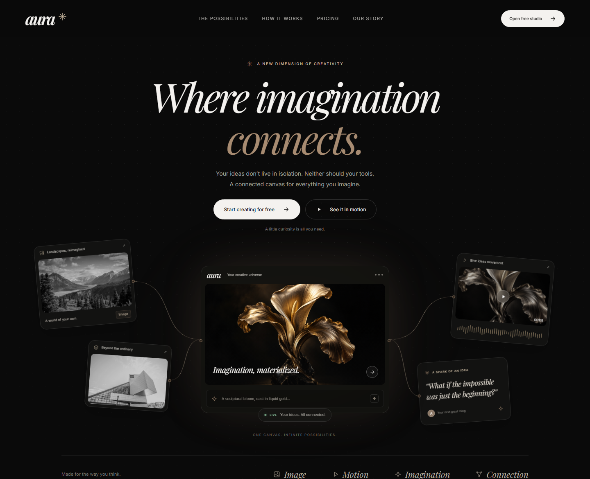
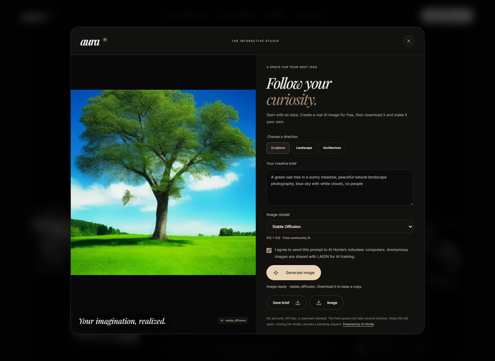

<div align="center">

# AURA AI Studio

### Where imagination connects.

A black-and-gold creative canvas with free AI image generation, thoughtful motion, and a responsive interface.

[](https://akmalzokirjonov.github.io/aura-ai-studio/)
[](https://github.com/akmalzokirjonov/aura-ai-studio/actions/workflows/ci.yml)
[](app.js)
[](https://akmalzokirjonov.github.io/aura-ai-studio/)

[Explore the site](https://akmalzokirjonov.github.io/aura-ai-studio/) · [Run locally](#run-locally) · [How AI works](#free-ai-and-privacy)

</div>



## Create something of your own

Open the studio, describe an image, choose a model, and generate. AURA connects directly to AI Horde's volunteer network, then lets you download the result or save your creative brief.

**No account, private API key, backend, or paid subscription is required for image generation.** Availability depends on volunteer workers and the anonymous queue.

1. Open **[AURA](https://akmalzokirjonov.github.io/aura-ai-studio/)** and select **Open free studio**.
2. Write a prompt and choose **Smart choice**, **Stable Diffusion**, or **Deliberate**.
3. Read and acknowledge the provider's sharing terms, then select **Generate image**.
4. Follow the queue status and download your image when it is ready.

<details>
<summary><strong>See a real AI-generated result in the studio</strong></summary>

<br>



This screenshot records a successful live request for a tree in a meadow. The studio received and displayed a 512 × 512 image from AI Horde. It is an example result, not a promise of queue speed or output quality.

</details>

## Inside the studio

| Create | Explore |
| --- | --- |
| Real AI images through Stable Diffusion and Deliberate | A neural canvas with responsive SVG connections |
| Live queue updates and request cancellation | Sculpture, landscape, and architecture references |
| Download generated images and creative briefs | Glass cards, bronze accents, and editorial typography |
| Keep separate prompts and results for each direction | Mobile layouts, keyboard navigation, and reduced motion |

The site also includes a motion study, a monthly/yearly pricing preview, and an illustrated studio story. **Video generation, Pro/Studio subscriptions, team collaboration, and email delivery are presentation concepts.** The digest form does not collect email addresses.

## Run locally

The website has no runtime packages and needs no build step.

```sh
git clone https://github.com/akmalzokirjonov/aura-ai-studio.git
cd aura-ai-studio
python -m http.server 4173 --bind 127.0.0.1
```

Open **[localhost:4173](http://127.0.0.1:4173/)**. Python 3 is used only to serve the static files; any static web server works.

To run the automated tests with Node.js 20 or newer:

```sh
npm test
```

No `npm install` is needed. Tests use Node's built-in test runner and simulated provider responses, so they do not consume volunteer GPU time. GitHub Actions runs the same checks on pushes and pull requests.

## Free AI and privacy

AURA uses the [AI Horde API](https://aihorde.net/api/) with its [documented anonymous credential](https://github.com/Haidra-Org/AI-Horde#anonymous-usage). The public value `0000000000` is not a private secret. Never replace it with a personal API key in browser code or in this repository.

- **Community availability:** anonymous requests have low priority and can be restricted during high load. The studio requests one 512 × 512 image and stops waiting after ten minutes.
- **Sharing acknowledgement:** prompts are processed by volunteer computers, and anonymous generated images are shared with LAION for AI training. Visitors must acknowledge this before any generation request is sent. Do not submit confidential prompts.
- **Local drafts:** AURA adds no analytics, cookies, or browser storage. Drafts and generated results stay in the current tab until downloaded; reloading clears them. GitHub Pages and AI Horde apply their own hosting and privacy policies.
- **Cancellation:** Cancel or close the studio to remove a pending request. If the network prevents confirmation, AURA says the provider may still finish it. Failed submissions are not automatically resubmitted.

Read [AI Horde's privacy policy](https://aihorde.net/privacy/) for the provider's terms. Model availability, moderation, and waiting times are controlled by the community service.

## Project structure

```text
aura-ai-studio/
├── index.html                 # Page sections and accessible dialogs
├── styles.css                 # Theme, responsive layouts, and motion
├── app.js                     # Studio interactions and UI state
├── ai-horde.js                # Submit, poll, retrieve, and cancel AI jobs
├── assets/                    # Local images, fonts, icons, and font licenses
├── docs/                      # Actual website and generation screenshots
├── tests/ai-horde.test.js      # Provider lifecycle and error handling tests
└── .github/workflows/ci.yml    # Automated validation
```

## Deployment and verification

The **[live website](https://akmalzokirjonov.github.io/aura-ai-studio/)** is served from the root of `main` with GitHub Pages. Pushing to `main` publishes updates automatically. Relative asset paths support the repository subdirectory, and `.nojekyll` keeps deployment as plain static files.

Nine automated tests cover successful generation, cancellation during submission, rate limits without duplicate jobs, rejected submissions, unavailable workers, censored results, timeouts, expired requests, and input validation. Browser checks also cover downloads, scene preservation, consent before submission, mobile navigation, dialog focus, and layouts from 320 to 1440 pixels. A live AI request and the GitHub Pages-to-provider connection have been verified.

## Artwork and credits

The bronze flower artwork was generated for this project. Illustrative photography comes from Unsplash; typography uses Inter and Playfair Display with their SIL Open Font Licenses included. See **[ASSETS.md](ASSETS.md)** for image sources, the artwork prompt, and font credits. Studio photography does not depict actual AURA employees or offices.

---

<div align="center">

Designed and built by **[Akmal Zokirjonov](https://github.com/akmalzokirjonov)**

[Open AURA](https://akmalzokirjonov.github.io/aura-ai-studio/) · [Report an issue](https://github.com/akmalzokirjonov/aura-ai-studio/issues)

</div>
